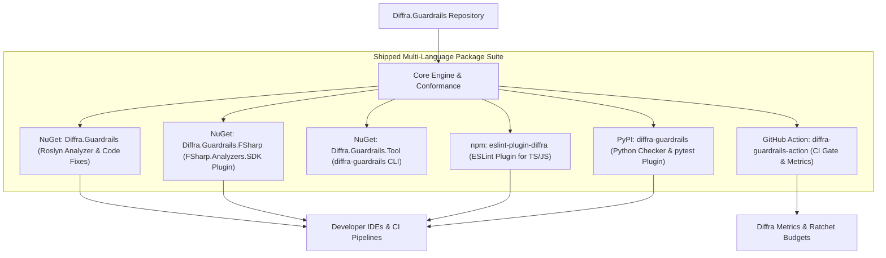
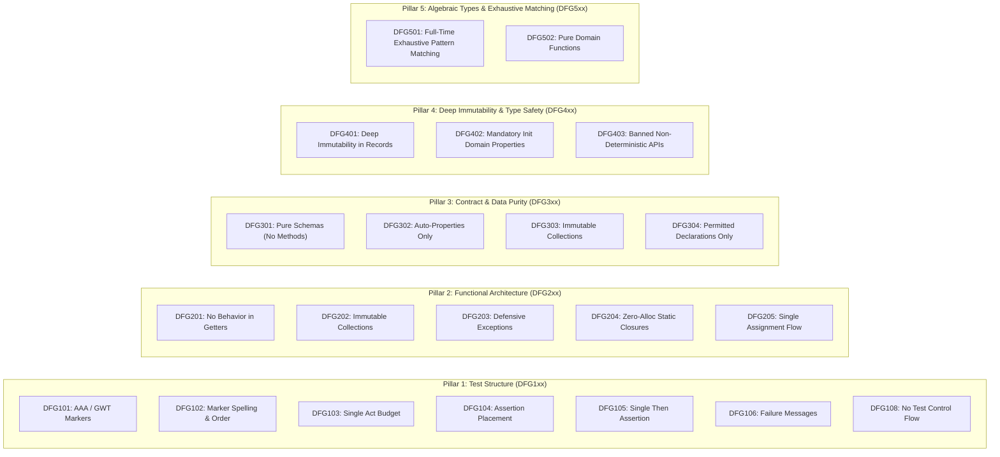

# Diffra Guardrails: Vision

Status: Specification & Vision, November 2026.

---

## 1. The Core Purpose: Narrowing to the Pit of Success

> *"The Pit of Success: in stark contrast to previous designs, a well-designed platform makes it
> easy to fall into winning practices and difficult to write bad code."*
> — **Rico Mariani**, Microsoft Principal Architect

Today, autonomous AI agents write an ever-expanding share of production code and test suites. While
these agents can quickly achieve passing tests and green checkmarks, they frequently fall into a
**pit of procedural despair**:

- Generating unmaintainable "Assertion Roulette" tests with no explanation of failure.
- Concealing cyclomatic complexity, loops, and conditional branching inside test bodies.
- Stuffing complex LINQ queries, collection allocations, and loops into property getters.
- Mutating shared collections in place (`Add`, `Remove`, `Sort`), creating temporal coupling.
- Swallowing broad exceptions (`catch (Exception) {}`), destroying observability and stack traces.
- Spawning heap delegate allocations through unconstrained, non-static closures.
- Declaring uninitialized mutable variables and conditionally reassigning them across procedural
  branches instead of using single-assignment expressions.

Open-ended guidance (such as *"write clean, functional code"* or *"write readable tests"*) fails to
prevent these failure modes. By the time a PR reviewer or a CI pipeline objects twenty minutes later,
remediating the code requires costly context switching and rework.

**Diffra Guardrails provides deterministic structural boundaries that steer developers and AI
agents directly into the Pit of Success.** By delivering instant, actionable constraints at the
exact moment code is authored, the right architecture becomes the natural default.

---

## 2. A Multi-Language Suite of Packages

Diffra Guardrails is not a single monolith or language-bound linter. It is a **cohesive suite of
native packages**, engineered in this repository and shipped across the primary package registries
of modern software engineering:



### The Shipped Artifacts

1. **`Diffra.Guardrails` (NuGet):**
   A zero-dependency Roslyn DiagnosticAnalyzer and CodeFixProvider for C# that runs live inside
   Visual Studio, VS Code (C# Dev Kit), and `dotnet build`.
2. **`Diffra.Guardrails.FSharp` (NuGet):**
   An `FSharp.Analyzers.SDK` package bringing native F# compiler AST analysis to Ionide, Rider, and
   command-line tooling.
3. **`Diffra.Guardrails.Tool` (NuGet):**
   A fast, cross-platform CLI tool (`diffra-guardrails`) for sub-second edit-time feedback, agent
   hooks, and Diffra payload generation.
4. **`eslint-plugin-diffra` (npm):**
   An ESLint plugin enforcing structural test constraints and functional TypeScript idioms across
   Vitest, Jest, and web applications.
5. **`diffra-guardrails` (PyPI):**
   A zero-dependency Python package combining stdlib AST and token analysis with a pytest runner
   plugin.
6. **`diffra-guardrails-action` (GitHub Marketplace):**
   A composite action providing automated PR annotations, merge gating on changed code, and Diffra
   ratchet telemetry.

### 2.1 Core Principle: Native Ecosystem Integration (Zero Forking)

A foundational architectural invariant of Diffra Guardrails is to **fit natively into the ecosystem of tools where viable, avoiding forking linting into different ecosystems**:

1. **Meet Developers in Their Native Workflow:**
   - **.NET / C#:** Standard Roslyn `DiagnosticAnalyzer` & `CodeFixProvider` via NuGet. Integrates directly into `dotnet build`, `dotnet format`, Visual Studio, and VS Code C# Dev Kit with zero external processes.
   - **TypeScript / JS:** Standard ESLint plugin (`eslint-plugin-diffra`) via npm. Integrates directly into `eslint .`, `next lint`, Prettier, and editor extensions.
   - **Python:** Standard plugin via PyPI integrating directly with `pytest`, `ruff`, or `flake8` using native AST visitors.
   - **F#:** Standard `FSharp.Analyzers.SDK` package running natively within Ionide, Rider, and compiler tooling.

2. **Reuse Existing Native Diagnostics; Build Only the Gaps:**
   - Where an ecosystem already possesses robust rules (e.g. `CA1024` and `CA1031` in .NET SDK, `PT012` in pytest, or `@typescript-eslint` rules), Diffra reuses, configures, and maps them to the DFG canonical model rather than rebuilding redundant checks or forking linter engines.
   - For novel architectural constraints where no upstream tooling exists (such as DFG1xx test shape, DFG3xx contract purity boundaries, DFG4xx deep immutability, and DFG5xx full-time union exhaustiveness), Diffra authors native plugins conforming to the host ecosystem's standard extension points.

3. **Unified Governance & Ratchets:**
   - While execution remains native and un-forked, Diffra provides the unifying rule contract, cross-language conformance validation, and ratchet metric budgets across the entire software estate.

---

## 3. Two Pillars of Guardrails

Every package in the suite checks one unified catalog of canonical rules, split into two foundational
pillars:



### Pillar 1: Test Structure & Semantics (`DFG1xx`)

Tests exist to pin down behavior and diagnose failures. Tests that violate structural boundaries
obscure failure causes and increase maintenance overhead:

- **DFG101 (Markers Present):** Test must declare explicit `Arrange/Act/Assert` or
  `Given/When/Then` comment markers.
- **DFG102 (Marker Spelling & Order):** Markers must be correctly spelt and ordered (autofixable).
- **DFG103 (Act Budget):** Act block budget is strictly proportional to test size (small test = 1
  action). Prevents Eager Tests.
- **DFG104 (Assertion Placement):** Assertions must reside in the Assert/Then block, not hidden in
  setup.
- **DFG105 (Single Assertion per Then):** Exactly one assertion per Then block, unless using a
  registered compound helper. Eliminates Assertion Roulette.
- **DFG106 (Failure Message):** Assertions must declare a diagnostic failure message saying *why* the
  check matters.
- **DFG108 (No Control Flow):** Prohibits `if`, loops, or `try` in test bodies. Prevents Conditional
  Test Logic.

### Pillar 2: Functional Architecture & Clean Code (`DFG2xx`)

Enforces modern functional programming hygiene across application code and test fixtures:

- **DFG201 (No Behavior in Property Getters):** Properties must be lightweight, $O(1)$,
  allocation-free accessors. Prohibits LINQ queries, collection allocations, and loops in getters.
- **DFG202 (Immutable Collections & Transformations):** Prohibits in-place mutation (`Add`,
  `Remove`, `Clear`, `Sort`). Steers toward collection expressions (`[.. a, .. b]`) and pure
  transformations.
- **DFG203 (Defensive Exception Discipline):** Prohibits broad or swallowed exceptions (`catch
  (Exception) {}`); requires explicit types, exception filters (`when`), or rethrow (`throw;`).
- **DFG204 (Zero-Allocation Closures):** Lambdas and local functions that capture no outer variables
  must be marked `static` to eliminate closure heap allocations.
- **DFG205 (Single Assignment & Expression Flow):** Prohibits declaring a mutable variable followed
  by conditional branch reassignment; enforces switch expressions, ternary operators, or early
  returns.

### Pillar 3: Contract & Data Purity (`DFG3xx`)

Strictly segregates pure schemas and data objects from behavioral execution pipelines:

- **DFG301 (No Methods in Contract Types):** Pure contract types must not declare instance methods;
  behavior belongs in standalone domain functions.
- **DFG302 (Auto-Properties Only in Contracts):** Contract properties must be pure auto-properties
  (`{ get; init; }` or `{ get; }`); no computed getters or expression bodies.
- **DFG303 (Immutability & Collection Safety):** Prohibits mutable setters (`set;`) and mutable
  collection types (`List<T>`) in favor of `IReadOnlyList<T>` and `ImmutableArray<T>`.
- **DFG304 (Permitted Declaration Kinds):** Types in contract boundaries must be `record class`,
  `record struct`, `enum`, `interface`, or static constants containers.

### Pillar 4: Deep Immutability & Type Safety (`DFG4xx`)

Enforces deep object and collection immutability, immutable domain properties, and eliminates
uncontrolled runtime side-effects:

- **DFG401 (Deep Immutability in Records):** Records and value types must not reference mutable classes
  or collections.
- **DFG402 (Mandatory Init Domain Properties):** Domain types must declare `{ get; init; }` or get-only
  properties; mutable setters (`set;`) are prohibited.
- **DFG403 (Banned Non-Deterministic & Blocking APIs):** Prohibits direct system clock reads
  (`DateTime.Now`/`UtcNow` in favor of `TimeProvider`), thread sleeping (`Thread.Sleep`), and synchronous
  task blocking (`.Result`/`.Wait()`).

### Pillar 5: Algebraic Types & Exhaustive Matching (`DFG5xx`)

Turns pattern matching exhaustiveness into a full-time compile-time invariant and enforces pure functions:

- **DFG501 (Full-Time Exhaustive Pattern Matching):** Prohibits wildcard discards (`_ => ...`) on closed
  union hierarchies, enums, and discriminated unions, guaranteeing unhandled variants cause compiler errors.
- **DFG502 (Pure Domain Functions):** Domain operations must be pure static functions returning new state
  rather than mutating instance fields.

---

## 4. Architectural Style Bundles: Purity vs. High Performance

Pure functional immutability and zero-allocation systems programming can sometimes conflict. In hot
paths, compilers, parsers, and AST analyzers, pure collection copying can cause garbage collection
churn.

Diffra Guardrails resolves this through **Architectural Style Bundles**:

| Bundle | Primary Target | Immutability (DFG202) | Closures (DFG204) | Expression Flow (DFG205) |
| --- | --- | --- | --- | --- |
| **`functional`** | Domain logic, APIs, business models | Strict error; only `[.. a, b]` and pure transforms | Strict `static` error | Strict switch / ternary |
| **`high-performance`** | Roslyn analyzers, parsers, compilers | Scoped builders allowed (`ImmutableArray.Builder`) | Strict `static` error (zero alloc) | Loops/imperative flow allowed in hot paths |
| **`pragmatic`** (Default) | General application code | Immutable public surfaces; local private builders | Strict `static` error | Switch / ternary / early return |

Configurable per project or directory via unified config (`diffra.config.json`) or native tool
configurations (`.editorconfig`, `eslint.config.js`, `pyproject.toml`). (See [docs/rules/style-bundles.md](docs/rules/style-bundles.md)).

---

## 5. Grounded in Literature & Empirical Research

Every rule is justified by empirical defect research and language performance architecture:

- **Smells Predict Maintenance Cost:** Empirical studies (including PyNose, Wang et al., ASE 2021)
  link Assertion Roulette and Conditional Test Logic directly to maintenance overhead and flakiness.
- **Lightweight Accessor Contract:** Microsoft Framework Design Guidelines dictate that property
  getters must not perform complex computations or allocate new collections.
- **Collection Expression Optimization:** Stephen Toub's architectural analyses show how C#
  collection expressions (`[.. a, .. b]`) avoid reallocation cliffs compared to procedural loops.
- **Zero-Allocation Delegating:** Konrad Kokosa's *Pro .NET Memory Management* demonstrates that
  non-static closures in loops are a primary source of Gen-0 garbage collection pressure.
- **Fail-Fast Observability:** Martin Fowler's Fail-Fast principle and Microsoft exception standards
  forbid broad catch swallowing to prevent quiet domain corruption.

Full bibliography and durable links are maintained in
[docs/architecture/literature-and-benchmarks.md](docs/architecture/literature-and-benchmarks.md).

---

## 6. The Conformance Corpus: The Cross-Language Oracle

A rule changes in the **conformance corpus** first, then in each language package.

The corpus contains **39 cross-language test suites** (cases `001` through `039`), each written in
C#, Python, and TypeScript, paired with an exact `expected.json` oracle. A language package is
certified only when its checker reports 100% agreement with the corpus findings. Dialect drift is
strictly prohibited.

```text
conformance/
  cases/
    001-marked-small-test/               # Target test shape (none)
    002-two-assertions-without-messages/ # Assertion Roulette (DFG105, DFG106)
    ...
    004-property-getter-with-linq/       # LINQ query in getter (DFG201)
    005-collection-add-mutation/         # In-place Add mutation (DFG202)
    ...
    033-clean-early-return/              # Clean single assignment via guard clauses (none)
```

---

## 7. Public Finding & Fix Contracts

Findings are designed to be consumed directly by autonomous AI agents inside their edit loops. Every
finding guarantees a stable, deterministic public contract:

```json
{
  "rule": "DFG201",
  "path": "src/Catalog/Pricing.cs",
  "line": 14,
  "endLine": 14,
  "block": null,
  "scope": "new",
  "severity": "error",
  "gated": true,
  "message": "Property getter 'DiscountedItems' contains non-trivial behavior (LINQ query invocation); property getters must be lightweight, allocation-free accessors.",
  "fix": "Convert 'DiscountedItems' to a method, or precompute and store the value in an init-only property or field."
}
```

`message` and `fix` strings are immutable contracts. An agent reading the diagnostic receives the
exact remediation action required to succeed.

---

## 8. Gating & The Diffra Metrics Ratchet

Guardrails produces evidence; Diffra manages policy:

- **Changed-Code Gate:** In pull requests, only new and modified code is gated. Legacy untouched
  code never breaks a build.
- **Metrics Ratchet:** Untouched code is continuously scored into Diffra metrics payloads
  (`test-structure-v1` and `functional-architecture-v1`).
- **Zero Day-One Failures:** Adoption requires no suite-wide rewrites. Diffra ratchets budgets downward
  over time, guaranteeing code quality cannot silently degrade.

---

## 9. Dogfooding Principle

**We run our own packages on ourselves on every build.**

The `Diffra.Guardrails` repository enforces its own analyzers across all subsystems:

- `Diffra.Guardrails.Core` runs under `bundle: functional` (pure records, init-only properties,
  collection expressions).
- `Diffra.Guardrails.CSharp` runs under `bundle: high-performance` (zero-allocation AST traversals,
  static lambdas, and scoped builders).
- `Diffra.Guardrails.Tool` runs under `bundle: pragmatic` (defensive exception flow, single
  assignment).

---

## 10. Summary: The Pit of Success

Diffra Guardrails replaces vague linting advice with an integrated suite of high-performance packages.
By making clean, functional, and well-structured code the path of least resistance, developers and AI
agents naturally fall into the Pit of Success.
