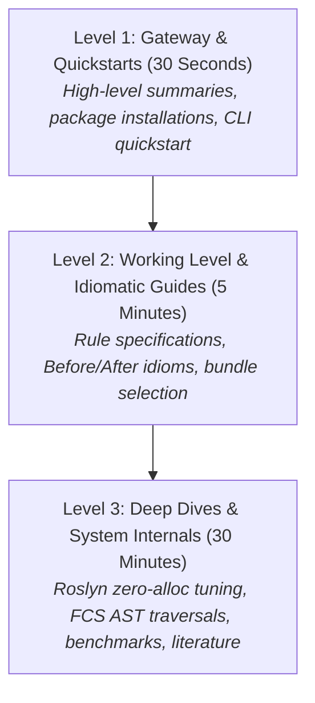

# Diffra Guardrails Documentation

Status: Current. Conforms to [VISION.md](../VISION.md) and [AGENTS.md](../AGENTS.md).

Welcome to the Diffra Guardrails documentation. Diffra Guardrails provides deterministic, multi-language structural boundaries that steer software engineers and autonomous AI agents into the **Pit of Success** (Rico Mariani).

---

## 1. The Progressive Disclosure Model

To prevent cognitive overload while providing exhaustive technical rigor, this documentation is structured around three progressive disclosure levels:

* **Level 1 (Gateway & Quickstarts)**: 30-second overviews, package installation, CLI invocation, and recommended style profiles.
* **Level 2 (Working Level & Idiomatic Guides)**: Complete rule catalogues, actionable messages, code fixes, and modern language guidance.
* **Level 3 (Deep Dives & System Internals)**: AST visitor architectures, zero-allocation syntax guards, benchmarking methodology, and upstream license audits.

---

## 2. Documentation Map by Language & Tool

Each language adapter and tool has its own dedicated directory designed to expand out independently:

| Ecosystem / Tool | Level 1: Quickstart | Level 2: Idioms & Guides | Level 3: Architecture & Deep Dives |
| :--- | :--- | :--- | :--- |
| **C# & .NET** | [csharp/README.md](csharp/README.md) | [csharp/guidance.md](csharp/guidance.md) | [roslyn-analyzer.md](csharp/roslyn-analyzer.md) &bull; [performance-tuning.md](csharp/performance-tuning.md) |
| **F#** | [fsharp/README.md](fsharp/README.md) | [fsharp/tooling-and-plan.md](fsharp/tooling-and-plan.md) | [FCS AST & Expecto Plan](fsharp/tooling-and-plan.md) |
| **TypeScript / JS** | [typescript/README.md](typescript/README.md) | [typescript/tooling-and-plan.md](typescript/tooling-and-plan.md) | [ESLint Plugin & Vitest Plan](typescript/tooling-and-plan.md) |
| **Python** | [python/README.md](python/README.md) | [python/tooling-and-plan.md](python/tooling-and-plan.md) | [AST/Tokenize & Pytest Plan](python/tooling-and-plan.md) |
| **CLI Tool** | [tool/README.md](tool/README.md) | [tool/interventions.md](tool/interventions.md) | [CI Ratchet & Metrics Payloads](tool/interventions.md) |
| **Rule Contracts** | [rules/README.md](rules/README.md) | [DFG1xx: Test Shape](rules/dfg1xx-test-structure.md) &bull; [DFG2xx: Functional](rules/dfg2xx-functional-architecture.md) &bull; [DFG3xx: Contracts](rules/dfg3xx-contract-and-data-purity.md) &bull; [DFG4xx: Immutability](rules/dfg4xx-deep-immutability.md) &bull; [DFG5xx: Algebraic Types](rules/dfg5xx-algebraic-types.md) | [Style Bundles](rules/style-bundles.md) |
| **System Architecture** | [architecture/README.md](architecture/README.md) | [architecture/adapters.md](architecture/adapters.md) &bull; [architecture/dogfooding.md](architecture/dogfooding.md) | [Boundaries](architecture/contract-and-module-boundaries.md) &bull; [Literature](architecture/literature-and-benchmarks.md) &bull; [Upstream](architecture/upstream-inspirations-and-attribution.md) |

---

## 3. Fast-Track Navigation Matrix

Find what you need based on your role or objective:

### "I am an engineer or AI agent fixing a rule violation"

1. Check the rule specification in [rules/dfg1xx-test-structure.md](rules/dfg1xx-test-structure.md) (Test rules) or [rules/dfg2xx-functional-architecture.md](rules/dfg2xx-functional-architecture.md) (Clean code rules).
2. For C#, review the modern functional idioms and code examples in [csharp/guidance.md](csharp/guidance.md).
3. If an architectural tradeoff exists between immutability and hot-path throughput, consult [rules/style-bundles.md](rules/style-bundles.md).

### "I want to install or run the CLI guardrails"

1. Review the CLI commands and formatters in [tool/README.md](tool/README.md).
2. Configure edit-time agent hooks or pre-commit checks in [tool/interventions.md](tool/interventions.md).

### "I am building or extending a language adapter"

1. Read the universal adapter contract (The Six Questions) in [architecture/adapters.md](architecture/adapters.md).
2. Check the cross-language conformance matrix in [conformance/README.md](../conformance/README.md).
3. Review the specific language plan: [F#](fsharp/tooling-and-plan.md), [TypeScript](typescript/tooling-and-plan.md), or [Python](python/tooling-and-plan.md).

### "I am tuning an analyzer for zero-allocation performance"

1. Review the 5-step syntax reject guard methodology in [csharp/performance-tuning.md](csharp/performance-tuning.md).
2. Ground your implementation in documented benchmarks and Microsoft guidelines in [architecture/literature-and-benchmarks.md](architecture/literature-and-benchmarks.md).
3. Audit upstream lineage and permissive licensing (MIT/Apache 2.0) in [architecture/upstream-inspirations-and-attribution.md](architecture/upstream-inspirations-and-attribution.md).
