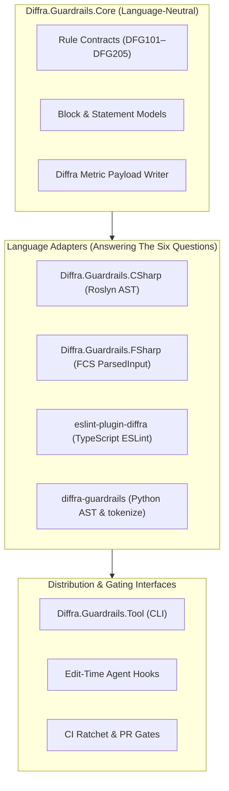

# System Architecture & Philosophy

Status: Current. Conforms to [VISION.md](../../VISION.md).

Diffra Guardrails is designed around a single guiding principle:

> *"The Pit of Success: in stark contrast to earlier APIs that were 'pit of despair' where you had
> to climb up this hill to do the right thing and the slightest slip would send you into failure,
> we want to design APIs and environments that make it easy to fall into winning practices and
> difficult to write bad code."*  
> — **Rico Mariani**, Microsoft Principal Architect

---

## 1. High-Level Architectural Model

Diffra Guardrails separates language-neutral contract definitions from language-specific AST adapters:

---

## 2. Progressive Documentation Path

* **[The Adapter Contract (The Six Questions) (Level 2)](adapters.md)**: How every language adapter extracts tests, statements, assertions, comments, sizes, and shared fixtures.
* **[Dogfooding Policy (Level 2)](dogfooding.md)**: How Guardrails enforces its own analyzers across Core, CSharp, and Tool on every build.
* **[Literature & Benchmarks (Level 3)](literature-and-benchmarks.md)**: Academic papers, Microsoft Framework Design Guidelines, and Stephen Toub performance blogs grounding our rules.
* **[Upstream Inspirations & Attribution (Level 3)](upstream-inspirations-and-attribution.md)**: Analysis of upstream open-source projects (NetAnalyzers, Meziantou, Roslynator, SharpSource), license compatibility (MIT/Apache 2.0), and attribution standards.
