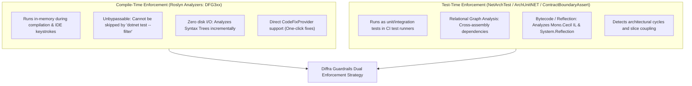

# Contract and Module Boundary Architecture Across Ecosystems

Status: Architectural Blueprint, November 2026. Conforms to [VISION.md](../../VISION.md).
Scope: Cross-language boundary enforcement across .NET, TypeScript, and Python.

---

## 1. Architectural Motivation

A cornerstone of functional software design is the **strict segregation of pure schemas from behavioral pipelines**:

```mermaid
flowchart LR
    subgraph Contracts["Pure Contracts & Schemas (DFG3xx)"]
        direction TB
        DTO["Records / DTOs"]
        Msg["Event Messages"]
        Enum["Enums & Constants"]
        Intf["Interface Schemas"]
    end

    subgraph Boundaries["Enforced Boundary Layer"]
        B1[".NET: &lt;EnforcePureContracts&gt;"]
        B2["TypeScript: eslint-plugin-boundaries / Nx"]
        B3["Python: tach / import-linter"]
    end

    subgraph Pipelines["Domain Pipelines & Services"]
        direction TB
        F1["Pure Functions"]
        F2["Workflows & Handlers"]
        F3["I/O Adapters"]
    end

    Contracts --- Boundaries --- Pipelines
    Pipelines -.->|"imports pure data"| Contracts
    Contracts -.-x|"prohibited from calling"| Pipelines
```



When data contracts mix with business operations:

1. **Serialization Contamination:** Methods and computed properties get serialized accidentally or trigger database queries during JSON formatting.
2. **Temporal Coupling:** Mutable properties allow state to change unpredictably across asynchronous boundary calls.
3. **Circular Dependencies:** Contracts import service logic, pulling whole dependency graphs into lightweight consumers.

Diffra Guardrails addresses this via **Contract and Module Boundary Enforcements**.

---

## 2. Boundary Patterns Across Ecosystems

### 2.1 The .NET & C# Ecosystem

In .NET, boundaries are enforced at both project and folder/namespace levels:

#### Project-Level Scoping

Schema projects declare contract purity in their project file or `Directory.Build.props`:

```xml
<Project Sdk="Microsoft.NET.Sdk">
  <PropertyGroup>
    <TargetFramework>net10.0</TargetFramework>
    <Nullable>enable</Nullable>
    <!-- Enforce DFG3xx contract purity across all types in this project -->
    <EnforcePureContracts>true</EnforcePureContracts>
  </PropertyGroup>
</Project>
```

#### Folder & Namespace Scoping via `.editorconfig`

Multi-layered projects declare contract zones via `.editorconfig`:

```ini
[*.cs]
# Define contract boundary paths and namespaces
diffra_guardrails.contract_paths = **/Contracts/**;**/Models/**;**/Dtos/**;**/Specs/**
diffra_guardrails.contract_namespaces = *.Contracts;*.Models;*.Dtos;*.Specs

# Enforce DFG3xx severity
dotnet_diagnostic.DFG301.severity = error
dotnet_diagnostic.DFG302.severity = error
dotnet_diagnostic.DFG303.severity = error
dotnet_diagnostic.DFG304.severity = error
```

#### Enforced Invariants

* **DFG301:** No methods in contract records (functions moved to static domain classes).
* **DFG302:** Only `{ get; init; }` or `{ get; }` auto-properties; no expression or block bodies.
* **DFG303:** No `set;` mutators; mutable collections (`List<T>`) replaced by `IReadOnlyList<T>`.
* **DFG304:** Types must be `record class`, `record struct`, `enum`, `interface`, or static constants.

---

### 2.2 The TypeScript & JavaScript Ecosystem

In TypeScript, boundaries are modeled using `eslint-plugin-boundaries` and Nx workspace project tags:

#### `eslint-plugin-boundaries` Configuration

```javascript
// eslint.config.js
import boundaries from "eslint-plugin-boundaries";

export default [
  {
    plugins: { boundaries },
    settings: {
      "boundaries/elements": [
        { type: "contracts", pattern: "src/contracts/**" },
        { type: "dto", pattern: "src/**/*.dto.ts" },
        { type: "domain", pattern: "src/domain/**" },
        { type: "services", pattern: "src/services/**" }
      ]
    },
    rules: {
      "boundaries/element-types": [
        "error",
        {
          default: "disallow",
          rules: [
            { from: "contracts", allow: [] }, // Contracts cannot import anything
            { from: "domain", allow: ["contracts"] },
            { from: "services", allow: ["domain", "contracts"] }
          ]
        }
      ]
    }
  }
];
```

#### Nx Module Boundaries (`@nx/enforce-module-boundaries`)

In Nx monorepos, projects tag boundaries (`scope:contracts`, `type:dto`):

```json
{
  "sourceTag": "scope:contracts",
  "onlyDependOnLibsWithTags": []
}
```

#### Enforced Invariants

* Interfaces and types contain only readonly fields (`readonly id: string`).
* Functions, class methods, and mutable arrays (`string[]`) are prohibited in contract files in favor of `readonly string[]` or `ReadonlyArray<string>`.

---

### 2.3 The Python Ecosystem

In Python, boundaries are enforced via `tach` and `import-linter`:

#### `tach` Modular Dependency Boundary (`tach.toml`)

```toml
[modules.contracts]
path = "src/contracts"
depends_on = [] # Zero dependencies allowed

[modules.domain]
path = "src/domain"
depends_on = ["contracts"]

[modules.services]
path = "src/services"
depends_on = ["domain", "contracts"]
```

Running `tach check` prevents any reverse imports from domain or database layers into the contracts module.

#### `import-linter` Configuration (`.importlinter`)

```ini
[importlinter]
root_package = my_project

[importlinter:contract:layers]
name = Layered Architecture Contract
type = layers
layers =
    services
    domain
    contracts
containers =
    my_project
```

#### Enforced Invariants

* Contracts use `@dataclass(frozen=True)` or `typing.NamedTuple`.
* Instance methods and mutable default collections are banned.

---

## 3. Cross-Ecosystem Comparison Matrix

| Capability | .NET / C# | TypeScript / JavaScript | Python |
| :--- | :--- | :--- | :--- |
| **Purity Analyzer** | `Diffra.Guardrails.CSharp` (`DFG3xx`) | `eslint-plugin-diffra` | `diffra-guardrails` |
| **Path Scoping** | `.editorconfig` (`contract_paths`) | `eslint-plugin-boundaries` | `tach` (`modules.<name>.path`) |
| **Namespace Scoping** | `diffra_guardrails.contract_namespaces` | Element types | `import-linter` package layers |
| **Project Boundary** | `<EnforcePureContracts>true</EnforcePureContracts>` | Nx tags (`type:contracts`) | `tach.toml` dependencies |
| **Immutable Schemas** | `record class Foo(int Id, IReadOnlyList<T> Items)` | `interface Foo { readonly id: number; readonly items: readonly T[]; }` | `@dataclass(frozen=True)` / `Sequence[T]` |
| **Prohibited Elements** | Methods (`DFG301`), `set;` (`DFG303`), mutable `class` (`DFG304`) | Mutable methods, mutable arrays | Methods, un-frozen dataclasses |

---

## 4. Compile-Time (Roslyn) vs. Test-Time (NetArchTest / ArchUnitNET) Enforcement

A critical architectural decision is **where and when boundary rules should execute**:



### 4.1 Comparative Architectural Analysis

| Attribute | Compile-Time (Roslyn `DFG3xx`) | Test-Time (`NetArchTest` / `ContractBoundaryAssert`) |
| :--- | :--- | :--- |
| **Execution Point** | IDE edit-time & `dotnet build` | `dotnet test` execution stage |
| **Bypass Vulnerability** | **Zero.** Built into the compiler pipeline; fails the build. | **Moderate.** Developers or CI runners can run `--filter` or skip test projects. |
| **Incremental Scalability** | **Sub-millisecond.** Reanalyzes only modified files in-memory. | **Slower.** Requires disk compilation of all assemblies + IL bytecode decompilation. |
| **Compiler Noise Handling** | **Native.** `ISymbol.IsImplicitlyDeclared` cleanly filters record synthetic members. | **Complex.** Mono.Cecil sees `<Clone>$`, `<>c__DisplayClass`, and state machines as raw methods. |
| **Cross-Assembly Relational Checks** | **Limited.** Analyzers inspect single compilation boundaries. | **Exceptional.** Can query circular dependencies across the entire loaded estate. |
| **Remediation Experience** | **Instant.** IDE squiggles + one-click Roslyn `CodeFixProvider`. | **Post-Failure.** Requires opening test failure logs and manually editing files. |

### 4.2 Dual Enforcement in Diffra Guardrails

Diffra Guardrails supports **both mechanisms simultaneously**:

1. **Compile-Time via Roslyn (`DFG3xxContractPurityAnalyzer`):**
   * Pre-gates every file edit, build, and PR in sub-seconds.
   * Auto-repairs violations using Roslyn code fixes:
     * `DFG301RemoveMethodCodeFixProvider`
     * `DFG302ConvertComputedPropertyToAutoPropertyCodeFixProvider`
     * `DFG303MakePropertyInitCodeFixProvider`
     * `DFG304ConvertToRecordCodeFixProvider`
   * Scoped via `<EnforcePureContracts>true</EnforcePureContracts>`, assembly name patterns, `.editorconfig`, or `[PureContract]` attributes.

2. **Test-Time via Architectural Test Suites (`ContractBoundaryAssert`):**
   * Provides reflection and NetArchTest/ArchUnitNET compatible test assertions:
     ```csharp
     [Fact]
     public void Contracts_assembly_must_satisfy_pure_schema_rules()
     {
         ContractBoundaryAssert.AssertAssembly(typeof(OrderDto).Assembly);
     }
     ```
   * Enforces whole-solution architectural invariants, package independence, and relational boundaries in standard test harnesses.
