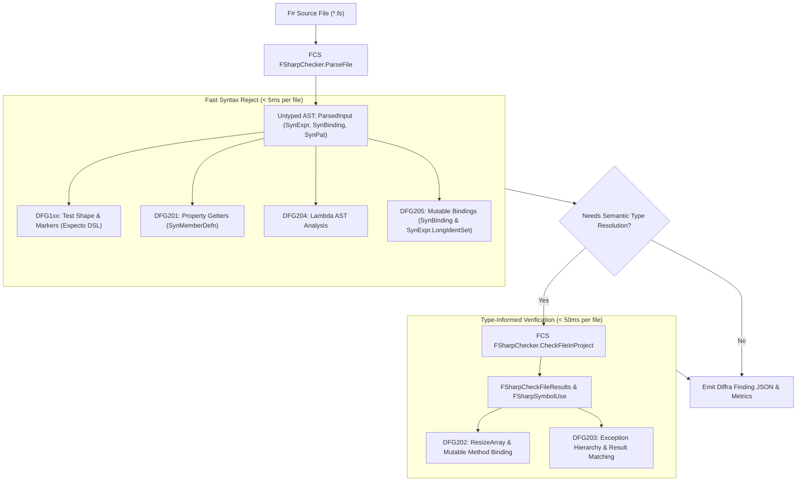

# F# Static Analysis, Compiler Tooling, and Functional Architecture Plan

Status: Architecture Plan & Technical Specification, November 2026.  
Scope: F# Language Adapter, `FSharp.Compiler.Service`, `FSharp.Analyzers.SDK`, rules DFG1xx and DFG2xx.

---

## 1. Executive Summary & Architectural Positioning

F# is an expression-first, functional-first programming language running on the .NET Common Language Runtime (CLR).
Unlike languages where functional idioms are layered atop an imperative object-oriented substrate, F# provides native
syntactic and semantic guarantees: bindings are immutable by default, control flow is expression-oriented, pattern
matching is exhaustive, and types favor algebraic data modeling (discriminated unions and records).

However, because F# compiles to the CLR and interoperates bidirectionally with C# and the broader .NET ecosystem, it
permits imperative escapes: mutable record fields, `mutable` local bindings, reference cells, `ResizeArray<T>`
mutations, unhandled exceptions, and property getters containing heavy computation. Furthermore, test suites written in
F# (utilizing Expecto or xUnit.net) frequently suffer from the same structural decays identified in empirical testing
literature: bloated assertion counts, missing failure messages, and indistinct Arrange-Act-Assert boundaries.

This document defines the architectural plan for the **F# Diffra Guardrails Adapter**. It establishes:

1. **The 6-Question Adapter Contract** for F# test frameworks (Expecto and xUnit).
2. **AST Analysis Architecture** utilizing `FSharp.Compiler.Service` (FCS), contrasting fast-reject untyped syntax
   trees (`ParsedInput`) with type-checked symbol models (`FSharpCheckFileResults`).
3. **Upstream Analyzer Lineage & Attribution** covering `FSharp.Analyzers.SDK`, G-Research analyzers, Fantomas, and Expecto.
4. **DFG1xx Test Constraints & DFG2xx Functional Architecture Rules** adapted to F# syntax and idioms.
5. **Reconciliation of Functional Idioms with High-Performance Systems Code** (local mutation encapsulation, struct tuples,
   and span-based zero-allocation computing).

---

## 2. Upstream Tooling, Technical Lineage & Licensing

The F# adapter leverages established compiler infrastructure and community analyzer frameworks. All upstream
inspirations are permissively licensed under MIT or Apache 2.0.

| Project | Repository & Link | License | Architectural Inspiration & Role in Diffra Guardrails |
| --- | --- | --- | --- |
| **FSharp.Analyzers.SDK** | [ionide/FSharp.Analyzers.SDK](https://github.com/ionide/FSharp.Analyzers.SDK) | MIT | The standard out-of-process analyzer hosting protocol for F#. Provides the plugin architecture for running custom AST checkers inside IDEs (Ionide, VS Code, Rider) and build pipelines. |
| **G-Research F# Analyzers** | [G-Research/fsharp-analyzers](https://github.com/G-Research/fsharp-analyzers) | Apache 2.0 | Battle-tested production analyzers for enterprise F#. Inspired Diffra's AST traversal patterns for detecting partial functions, record copy allocations, and mutable collection escapes. |
| **Fantomas** | [fsprojects/fantomas](https://github.com/fsprojects/fantomas) | Apache 2.0 | The official F# source code formatter. Informs Diffra's AST trivia management, comment range extraction, and automated code-fix formatting. |
| **Expecto** | [haf/expecto](https://github.com/haf/expecto) | Apache 2.0 | First-class functional test framework for F#. Defines the list-oriented test DSL (`testList`, `testCase`, `testCaseAsync`) and assertion model (`Expect.*`) targeted by DFG1xx. |
| **FSharp.Compiler.Service (FCS)** | [dotnet/fsharp](https://github.com/dotnet/fsharp) | MIT | The core F# compiler service providing AST parsing (`ParsedInput`, `SynExpr`, `SynPat`, `SynBinding`) and type checking. |

### Upstream Attribution & License Compatibility

All components integrated or referenced by the F# adapter adhere strictly to permissive licensing. No copyleft
(GPL/LGPL) dependencies are utilized. Findings emitted by Diffra Guardrails cite upstream rule IDs where direct
equivalences exist (e.g., G-Research partial function warnings aligning with DFG203).

---

## 3. The Six-Question Adapter Contract for `F#`

The Diffra Guardrails adapter contract normalizes language-specific syntax into uniform semantic queries. For F#, the
primary targets are **Expecto** (the idiomatic functional test tree library) and **xUnit.net** (the primary class/method
runner in .NET).

| Question | Expecto Implementation | F# xUnit.net Implementation |
| --- | --- | --- |
| **1. What is a test?** | AST calls to `testCase`, `testCaseAsync`, `testCaseTask`, `testProperty`, `testPropertyWithConfig`, and `ptestCase` within a `testList` structure. | Methods adorned with `[<Fact>]`, `[<Theory>]`, or `[<Property>]` attributes inside an F# module or type. |
| **2. What is an assertion?** | Calls to `Expect.*` functions (e.g., `Expect.equal`, `Expect.isTrue`, `Expect.isSome`, `Expect.sequenceEqual`), Unquote assertions (`test <@ ... @>`), or registered helpers. | Calls to `Assert.*` (xUnit), `Should*` assertions (FsUnit), or registered helper functions. |
| **3. Where is the failure message?** | The **last argument** of `Expect.*` functions: `Expect.equal actual expected "message"`. | The `userMessage` parameter in `Assert.True(cond, "message")`, or second parameter in custom helpers. |
| **4. How are comments reached?** | FCS `ParsedInput` trivia or tokenized comment ranges from `FSharpLexer` mapped to AST text spans. | Same as Expecto: tokenized trivia stream correlated to syntax ranges (`range` objects in FCS). |
| **5. How is size declared?** | Expecto list naming convention (e.g., `testList "small" [...]`), list tags (`testList "..." [...] \|> testFixture ...`), or custom metadata wrappers. | Attributes on the test method or module: `[<Trait("Size", "Small")>]`, `[<Category("Medium")>]`. |
| **6. How is shared context expressed?** | Higher-order test fixture functions passed as arguments (e.g., `withFixture`, `withDatabaseConnection (fun db -> ...)`). | Module-level `let` bindings, class constructors, or `IClassFixture<'T>` implementations. |

---

## 4. AST Traversal Architecture: Untyped vs. Typed Checking

A critical design challenge in F# tooling is the performance disparity between untyped AST inspection and full semantic
type checking via `FSharp.Compiler.Service`.



### 4.1 Fast-Reject Phase (Untyped AST)

Over 85% of Diffra Guardrails rules can be evaluated purely against the untyped AST (`FSharp.Compiler.Syntax.ParsedInput`):

- **Zero Typecheck Overhead:** `FSharpChecker.ParseFile` executes in 1–5ms per file without loading referenced project
  binaries or external NuGet assemblies.
- **Node Matching:**
  - `SynExpr.App`: Function application, matching `Expect.equal`, `testCase`, and assertion invocations.
  - `SynMemberDefn.Member`: Property accessors vs. methods.
  - `SynExpr.Lambda`: Lambda expressions analyzed for variable capture.
  - `SynBinding`: Bindings inspected for the `mutable` flag (`isMutable = true`).
  - `SynExpr.LongIdentSet`: In-place mutation operator (`<-`).

### 4.2 Type-Informed Phase (Typed AST)

For rules requiring semantic symbol disambiguation (e.g., distinguishing between an immutable `List.map` and an in-place
mutation on an external .NET `System.Collections.Generic.List<'T>`):

- `FSharpCheckFileResults.GetSymbolUseAtLocation`: Resolves whether an identifier binds to an F# core immutable module or
  an external mutable type.
- Evaluated lazily: only invoked when an untyped candidate node passes the fast syntax reject gate.

---

## 5. DFG1xx Test Constraints for `F#`

### 5.1 DFG101: Single Concept per Test

- **Target:** First argument of `testCase`, `testCaseAsync`, `testProperty`, or name of `[<Fact>]` function.
- **Check:** Name must not contain conjunctions (`" and "`, `", and "`, `" as well as "`) or multiple action verbs
  indicating multiple unrelated behaviors tested in a single unit.

### 5.2 DFG102: Explicit Arrange-Act-Assert Markers

- **Target:** Comments within test lambdas (`testCase "..." (fun () -> ...)`).
- **Extraction:** In F#, comments are preserved in `FSharpCompilerService` via syntax trivia or can be tokenized via
  `FSharpLexer`.
- **Contract:** Markers must appear as standalone single-line comments:

  ```fsharp
  testCase "Computing total discount" <| fun () ->
      // Arrange
      let basket = { Items = [ { Price = 100M; Quantity = 2 } ] }
      
      // Act
      let result = calculateDiscount basket
      
      // Assert
      Expect.equal result 20M "Discount must match standard 10% policy"
  ```

- **Typo Guard:** Single-word comments of 4+ characters resembling markers (`// Arange`, // `Asert`) are flagged.

### 5.3 DFG103 & DFG104: Act Block Size and Contiguity

- **Target:** Expressions between `// Act` and `// Assert`.
- **Constraint:** The Act block must consist of a single expression or a single binding statement. Multi-step workflows
  belong in Arrange fixtures or domain orchestration helpers.

### 5.4 DFG105: Single Assertion & Compound Verification

- **Target:** Expecto assertions (`Expect.*`) or Unquote quotations (`test <@ ... @>`).
- **Constraint:** Exactly one assertion expression allowed per test. Compound assertions must be wrapped in a registered
  helper function (e.g., `verifyCustomerStatus customer expectedTier expectedBalance`).

### 5.5 DFG106 & DFG107: Failure Message Slots & Quality

- **Target:** The failure message argument of Expecto functions.
- **Expecto Invariant:** Expecto places the diagnostic failure message as the **last argument** of the assertion:

  ```fsharp
  Expect.equal actual expected "Descriptive explanation of the failure mode"
  ```

- **Evaluation:**
  - Missing or empty message (`""`): DFG106 finding.
  - Generic message (`"values should match"`, `"test failed"`): DFG107 quality reduction.
  - Assertions lacking a message parameter emit a non-gated DFG106 warning.

---

## 6. DFG2xx Functional Architecture Rules for `F#`

While F# encourages functional programming, it does not strictly prevent procedural corruption. DFG2xx enforces clean
functional boundaries across domain models and application layers.

### 6.1 DFG201: No Behavior in Property Getters

- **AST Target:** `SynMemberDefn.Member` where the binding signature has no unit argument (e.g., `member this.Prop = ...`
  rather than `member this.Method() = ...`).
- **Detection Criteria:**
  - Prohibits pipeline transformations involving `Seq.*`, `List.filter`, `List.map`, or database/IO queries inside
    getters.
  - Prohibits object or collection allocations (`[ ... ]`, `ResizeArray()`, `dict [ ... ]`).
- **Message Contract:** `"Property getters must be O(1) allocation-free accessors. Move computational logic to a method."`
- **Fix Contract:** `"Convert the property to a member method by adding parameter () or arguments."`

### 6.2 DFG202: Immutable Collections & Pure Transformations

- **AST Target:**
  - Usages of `ResizeArray<'T>` (`System.Collections.Generic.List<'T>`).
  - Usages of `System.Collections.Generic.Dictionary<'K, 'V>` or `HashSet<'T>`.
  - Invocations of mutating methods: `.Add()`, `.Remove()`, `.Clear()`.
  - Record types declared with `[{<CLIMutable>}]` or fields marked `mutable`.
- **Detection Criteria:** Flag any mutable collection or field in domain types unless exempted by a high-performance
  attribute.
- **F# Replacement Idioms:**
  - Use idiomatic immutable collections: `list<'T>`, `Map<'Key, 'Value>`, `Set<'T>`, or `array<'T>` when treated as
    read-only.
  - Use record copy-and-update expressions: `{ customer with Balance = newBalance }`.

### 6.3 DFG203: Defensive Exception Discipline & Railway-Oriented Programming

- **AST Target:** `SynExpr.TryWith` nodes.
- **Detection Criteria:**
  - Prohibits broad catch-all handlers: `with | _ -> ()` or `with | :? System.Exception -> ()`.
  - Prohibits swallowed exceptions where the catch block does not call `reraise()`.
- **Recommended Architectural Pattern:**
  - Replace exceptions with F#'s native `Result<'T, 'Error>` type (Railway-Oriented Programming).
  - Use pattern matching over union cases instead of exception throwing and catching for domain flow control.

  ```fsharp
  // Procedural Anti-Pattern (Flagged by DFG203)
  try
      let result = parseOrder rawJson
      saveToDatabase result
  with
  | _ -> () // Swallowed fault!

  // Guardrailed Functional Architecture
  match parseOrder rawJson with
  | Ok order -> saveToDatabase order |> Result.map (fun () -> order.Id)
  | Error err -> Error (ProcessingFailed err)
  ```

### 6.4 DFG204: Zero-Allocation Closures & Value Types

- **AST Target:** `SynExpr.Lambda` expressions.
- **Detection Criteria:**
  - Flag lambda expressions in hot paths that capture enclosing variables when they could be defined at the module level
    or marked `inline`.
  - Flag standard heap-allocated tuples `(a, b)` where struct tuples `struct (a, b)` or `ValueOption<'T>` eliminate GC
    pressure.
- **Message Contract:** `"Lambda allocates a closure heap object. Hoist to module level or mark enclosing function inline."`

### 6.5 DFG205: Single Assignment & Expression Flow

- **AST Target:**
  - `SynBinding` where `isMutable = true`.
  - `SynExpr.LongIdentSet` (`identifier <- newValue`).
- **Detection Criteria:**
  - Prohibits procedural local variables declared `mutable` and iteratively updated, when an `if/then/else` expression,
    `match` expression, or `List.fold` achieves single assignment.

  ```fsharp
  // Procedural Anti-Pattern (Flagged by DFG205)
  let mutable status = "Pending"
  if age >= 18 then
      status <- "Active"
  else
      status <- "Minor"

  // Guardrailed Expression-Oriented Flow
  let status =
      if age >= 18 then "Active"
      else "Minor"
  ```

---

## 7. Reconciling Functional Idioms with High-Performance Systems

F# is frequently employed in high-throughput financial systems, algorithmic trading, and compiler engineering where
uncontrolled allocation triggers devastating GC pauses. Diffra Guardrails resolves this tension through the **Principle
of Encapsulated Mutation** (analogous to the Haskell ST Monad).

### 7.1 Encapsulated Procedural Scratchpads

Local mutation is strictly permitted if and only if:

1. The mutable state is instantiated, modified, and finalized entirely within a single function boundary.
2. The function returns an immutable value.
3. No references to the mutable state escape the stack.

```fsharp
// PERMITTED: Encapsulated scratchpad for high-performance matrix multiplication
let multiplyMatrices (a: float[,]) (b: float[,]) : float[,] =
    let rowsA = Array2D.length1 a
    let colsA = Array2D.length2 a
    let colsB = Array2D.length2 b
    let result = Array2D.zeroCreate rowsA colsB // Scratchpad allocation
    for i = 0 to rowsA - 1 do
        for j = 0 to colsB - 1 do
            let mutable sum = 0.0
            for k = 0 to colsA - 1 do
                sum <- sum + a.[i, k] * b.[k, j]
            result.[i, j] <- sum
    result // Returns immutable domain representation
```

### 7.2 Low-Allocation Primitives

The analyzer provides first-class support for modern .NET zero-allocation primitives:

- `Span<'T>` and `ReadOnlySpan<'T>`.
- Struct records: `[<Struct>] type Point = { X: float; Y: float }`.
- Struct discriminated unions: `[<Struct>] type Shape = Circle of float | Rectangle of float * float`.
- ValueOption: `ValueSome(x)` and `ValueNone`.

---

## 8. Architectural Style Bundles for `F#`

Like the C# adapter, the F# adapter supports three operational bundle profiles:

| Profile | Target Audience | DFG201 | DFG202 | DFG203 | DFG204 | DFG205 |
| --- | --- | --- | --- | --- | --- | --- |
| `strict-functional` | Pure domain libraries, financial calculation engines, safety-critical systems | Error (Gated) | Error (No mutable collections/fields) | Error (Result/ROP mandatory) | Error (Inline & struct tuples enforced) | Error (Zero mutable variables) |
| `pragmatic` | Standard enterprise microservices, web APIs (Giraffe/Saturn), worker services | Error (Gated) | Error (Domain immutability; ResizeArray allowed in private helpers) | Error (No swallowed exceptions; typed catches allowed) | Warning (Flag heap closures in loops) | Error (Mutable flagged; exemptions for complex folds) |
| `high-performance` | Trading gateways, parsers, game loops, telemetry pipelines | Error (Gated) | Warning (Encapsulated buffers permitted) | Error (Exceptions banned from hot path) | Error (Zero closure allocation strictly gated) | Warning (Local mutation permitted for performance) |

---

## 9. Durable Literature, RFCs & Technical Bibliography

1. **Don Syme et al. — The F# 4.1 Language Specification:**
   *Durable Link:* <https://fsharp.org/specs/language-spec/4.1/FSharpSpec-4.1-latest.pdf>  
   *Authoritative Analysis:* Formal semantic definitions of F# syntax, computation expressions, immutability defaults,
   and untyped AST structures.
2. **F# Language Design RFCs (fsharp/fslang-design):**
   - *RFC FS-1006 (Struct Tuples):* <https://github.com/fsharp/fslang-design/blob/main/RFCs/FS-1006-struct-tuples.md>
   - *RFC FS-1097 (Anonymous Records):* <https://github.com/fsharp/fslang-design/blob/main/RFCs/FS-1097-anonymous-records.md>
   - *RFC FS-1043 (nameof operator):* <https://github.com/fsharp/fslang-design/blob/main/RFCs/FS-1043-nameof-operator.md>
3. **Scott Wlaschin — Domain Modeling Made Functional & Railway-Oriented Programming:**
   *Durable Link:* <https://fsharpforfunandprofit.com/rop/>  
   *Authoritative Analysis:* Foundational architectural pattern for error handling using `Result<'T, 'Error>`, eliminating
   procedural try/catch blocks in favor of monadic railway composition.
4. **Mark Seemann (Ploeh) — Functional Architecture & Pure Interaction-Based Testing:**
   *Durable Link:* <https://blog.ploeh.dk/2017/10/04/from-interaction-based-to-state-based-testing/>  
   *Authoritative Analysis:* Demonstrates how pure functional data pipelines simplify testing, eliminating test doubles
   and reducing assertions to deterministic value comparisons.
5. **G-Research Engineering — Scaling F# in Quantitative Finance:**
   *Durable Link:* <https://www.gresearch.com/blog/article/f-in-finance-at-scale/>  
   *Authoritative Analysis:* Documents practical static analysis strategies and analyzer development for large-scale
   financial computing environments running millions of lines of F#.
