# Diffra Guardrails: Rule Catalogue & Contract

Status: Current. Conforms to [VISION.md](../../VISION.md).

Diffra Guardrails provides deterministic structural boundaries across testing structure and code architecture. Every rule is specified as an invariant with an immutable identifier, a stable finding message, and an actionable fix recommendation.

---

## 1. Rule Organization & Progressive Disclosure

The rule catalogue is structured across two progressive rule families:

```mermaid
flowchart TD
    subgraph DFG1xx["DFG1xx: Test Shape & Readability"]
        direction TB
        R101["DFG101: Structure Markers"]
        R102["DFG102: Marker Integrity"]
        R103["DFG103: Act Statement Budget"]
        R104["DFG104: Assertion Placement"]
        R105["DFG105: Assertion Budget"]
        R106["DFG106: Failure Message"]
        R107["DFG107: Mock Budget"]
        R108["DFG108: Test Cyclomatic Complexity"]
    end

    subgraph DFG2xx["DFG2xx: Functional Architecture & Clean Code"]
        direction TB
        R201["DFG201: No Behavior in Properties"]
        R202["DFG202: Immutability & No Mutations"]
        R203["DFG203: Defensive Exception Discipline"]
        R204["DFG204: Zero-Allocation Closures"]
        R205["DFG205: Single Assignment Expressions"]
    end

    subgraph DFG3xx["DFG3xx: Contract & Data Purity"]
        direction TB
        R301["DFG301: Pure Schemas (No Methods)"]
        R302["DFG302: Auto-Properties Only"]
        R303["DFG303: Immutable Collections"]
        R304["DFG304: Permitted Declarations Only"]
    end

    subgraph DFG4xx["DFG4xx: Deep Immutability & Type Safety"]
        direction TB
        R401["DFG401: Deep Immutability"]
        R402["DFG402: Mandatory Init Properties"]
        R403["DFG403: Banned Non-Deterministic APIs"]
    end

    subgraph DFG5xx["DFG5xx: Algebraic Types & Exhaustive Matching"]
        direction TB
        R501["DFG501: Full-Time Exhaustive Matching"]
        R502["DFG502: Pure Domain Functions"]
    end

    subgraph Bundles["Architectural Style Profiles"]
        B1["Functional Bundle"]
        B2["High-Performance Bundle"]
        B3["Pragmatic Bundle"]
    end

    DFG1xx --> Bundles
    DFG2xx --> Bundles
    DFG3xx --> Bundles
    DFG4xx --> Bundles
    DFG5xx --> Bundles
```



* **[DFG1xx: Test Structure Rules](dfg1xx-test-structure.md)**: Physical shape of unit and integration tests (markers, act statement budget, assertion roulette, failure messages).
* **[DFG2xx: Functional Architecture Rules](dfg2xx-functional-architecture.md)**: Clean code and functional discipline (lightweight property accessors, collection immutability, defensive exceptions, static lambdas, single assignment).
* **[DFG3xx: Contract & Data Purity Rules](dfg3xx-contract-and-data-purity.md)**: Segregation of pure data schemas from behavior, immutability, and boundary scoping.
* **[DFG4xx: Deep Immutability & Type Safety Rules](dfg4xx-deep-immutability.md)**: Deep immutability in records, mandatory init setters in domain models, and banned non-deterministic APIs (`DateTime.Now`, task blocking).
* **[DFG5xx: Algebraic Types & Exhaustive Matching](dfg5xx-algebraic-types.md)**: Full-time compile-time exhaustive pattern matching banning discard `_` on closed union types, and pure domain functions.
* **[Architectural Style Bundles](style-bundles.md)**: Configurable rule profiles balancing pure functional idioms with compiler hot-path performance requirements.

---

## 2. Public Finding Contract

Every Diffra Guardrails check emits findings conforming to a strict JSON structure:

```json
{
  "rule": "DFG201",
  "path": "src/OrderService.cs",
  "line": 14,
  "end_line": 14,
  "block": null,
  "severity": "error",
  "message": "Property getter 'Total' contains non-trivial behavior (LINQ query invocation); property getters must be lightweight, allocation-free accessors.",
  "fix": "Convert 'Total' to a method, or precompute and store the value in an init-only property or field."
}
```

### Invariants

1. **Rule IDs Never Change**: Rule identifiers (`DFG101`–`DFG205`) are permanent contracts. A retired rule retains its number and is never recycled.
2. **Deterministic Fixes**: Every message is accompanied by an actionable fix instruction that an automated agent or developer can follow directly.
3. **Language Neutrality**: Rule semantics are identical across all language adapters (C#, F#, TypeScript, Python). Conformance is proven via `conformance/cases/`.
