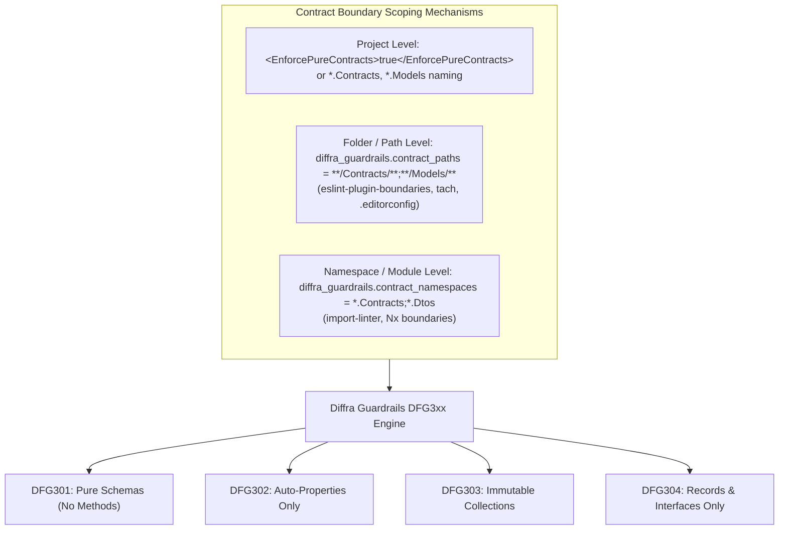

# DFG3xx: Contract & Data Purity Specification

Status: Specification & Design, November 2026. Conforms to [VISION.md](../../VISION.md).
Family: `DFG3xx` (Contract & Data Purity: Pure Data vs. Behavior Boundaries).

---

## 1. Overview & Motivation

In functional architecture, **state and logic are strictly segregated**:

* **Contracts & Schemas:** Pure data objects (records, DTOs, messages, events, enums, interfaces) define static schemas and wire contracts. They must contain zero computational behavior, zero hidden mutations, and zero business logic.
* **Domain Functions & Pipelines:** Pure functions, transformations, and workflows operate *on* contract data from outside, guaranteeing referential transparency and decoupling data serialization from domain execution.

The **DFG3xx** rule family enforces this architectural boundary within designated contract scopes (projects, folders, or modules).

---

## 2. Rule Catalogue

| ID | Name | Severity | Gate Policy | Failure Mode Prevented |
| :--- | :--- | :--- | :--- | :--- |
| **DFG301** | No Methods in Contract Types | Error | Gated | Embedding business behavior and side-effects inside pure data schemas |
| **DFG302** | Zero Behavior in Contract Getters | Error | Gated | Computed properties and calculations inside wire contracts |
| **DFG303** | Immutability & Collection Safety | Error | Gated | Mutable setters (`set;`) and mutable collection references (`List<T>`) in contracts |
| **DFG304** | Permitted Declaration Kinds Only | Error | Gated | Declaring mutable classes or unstructured types inside contract boundaries |

---

## 3. Boundary Scoping Mechanisms

Contract boundaries are opt-in and support both project-level and folder/namespace-level scoping:



### 3.1 Project-Level Boundaries

Projects targeting schemas (e.g., `*.Contracts.csproj`, `*.Models.csproj`, or projects setting `<EnforcePureContracts>true</EnforcePureContracts>`) apply DFG3xx rules to all types by default.

### 3.2 Folder & Namespace Boundaries

Repositories configure boundaries via `.editorconfig` or `diffra.config.json`:

```ini
# Folder and namespace scoping
[*.cs]
diffra_guardrails.contract_paths = **/Contracts/**;**/Models/**;**/Dtos/**;**/Specs/**
diffra_guardrails.contract_namespaces = *.Contracts;*.Models;*.Dtos;*.Specs
```

Equivalent cross-language boundary configurations:

* **TypeScript:** `eslint-plugin-boundaries` element types (`contracts`, `dto`, `messages`).
* **Python:** `tach.toml` modules or `import-linter` contracts.

---

## 4. Rule Specifications

### DFG301: Pure Contract Types Must Not Declare Methods

* **Rule ID:** `DFG301`
* **Category:** `ContractPurity`
* **Severity:** `Error`
* **Invariant:** Contract types must declare only data fields and properties. Instance methods, validation routines, and domain computations must be relocated to standalone domain functions or extension methods. Primary constructors and compiler-synthesized equality/clone members are exempt.
* **Message:** `Contract type '{type}' declares method '{method}'; pure contract types must contain only data schemas and no behavior.`
* **Fix:** `Move '{method}' to a standalone domain function or extension method.`

---

### DFG302: Property Getters Must Have Zero Behavior / Computation

* **Rule ID:** `DFG302`
* **Category:** `ContractPurity`
* **Severity:** `Error`
* **Invariant:** Contract properties must be pure auto-properties with `{ get; init; }` or `{ get; }`. Block-bodied getters, arrow-expression getters (`=>`), LINQ evaluations, allocations, or computations inside getters are prohibited.
* **Message:** `Contract property '{property}' in '{type}' contains computed behavior; contract properties must be pure auto-properties with '{ get; init; }' or '{ get; }'.`
* **Fix:** `Convert '{property}' to an auto-property, or move computation to a domain function.`

---

### DFG303: Immutability & Collection Safety

* **Rule ID:** `DFG303`
* **Category:** `ContractPurity`
* **Severity:** `Error`
* **Invariant:** Contract types must be strictly immutable once instantiated:
  1. Properties must not expose mutable setters (`set;`). Setters must be `init;` or get-only.
  2. Properties and constructor parameters must not expose mutable collection types (`List<T>`, `Dictionary<K, V>`, `HashSet<T>`). Collections must be read-only interfaces or immutable collections (`IReadOnlyList<T>`, `IReadOnlyDictionary<K, V>`, `ImmutableArray<T>`).
* **Sub-rules:**
  * **Mutable Setter:**
    * **Message:** `Contract property '{property}' declares a mutable setter 'set;'; contract properties must be immutable ('init;' or get-only).`
    * **Fix:** `Change 'set;' to 'init;' or remove setter.`
  * **Mutable Collection:**
    * **Message:** `Contract property '{property}' uses mutable collection type '{type}'; use immutable or read-only collections ('IReadOnlyList<T>', 'ImmutableArray<T>').`
    * **Fix:** `Replace '{type}' with 'IReadOnlyList<T>', 'IReadOnlyDictionary<K, V>', or 'ImmutableArray<T>'.`

---

### DFG304: Permitted Declaration Kinds Only

* **Rule ID:** `DFG304`
* **Category:** `ContractPurity`
* **Severity:** `Error`
* **Invariant:** Types declared inside a contract boundary must be structured data representations:
  * Permitted: `record class`, `record struct`, `enum`, `interface`, or `static class` containing exclusively `const` fields.
  * Prohibited: Standard mutable `class` declarations and mutable `struct` declarations.
* **Message:** `Type '{type}' is declared as '{kind}'; contract types must be 'record class', 'record struct', 'enum', 'interface', or a static constants container.`
* **Fix:** `Convert '{type}' to a record or interface, or move non-contract declarations outside the contract boundary.`
