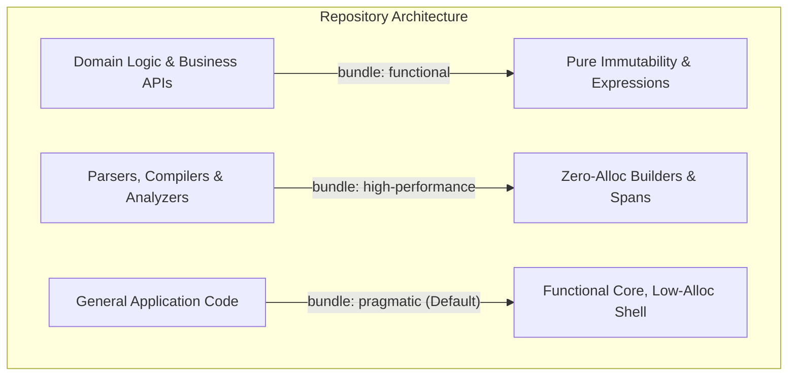

# Architectural Style Bundles: Reconciling Functional Purity and High Performance

Status: Architectural Specification, November 2026. Conforms to [VISION.md](../../VISION.md).
Scope: Diffra Guardrails Rule Profiles and Configuration Presets.

---

## 1. The Dilemma: Functional Purity vs. High-Performance Systems

A central insight in modern software engineering across C#, TypeScript, and Python is that **architectural styles can conflict**:

- **The Functional Style:** Maximizes correctness, thread-safety, and reasoning by enforcing
  immutable data, pure expressions, and zero in-place mutations (e.g., `[.. a, .. b]`, switch
  expressions, records).
- **The High-Performance / Systems Style:** In hot paths, compiler passes, and AST analyzers
  (including Roslyn analyzers themselves), allocating new collections or delegating to LINQ on every
  operation creates severe GC pressure, latency spikes, and cache thrashing. Systems code requires
  reusable buffers, `ReadOnlySpan<T>`, scoped builders (`ImmutableArray<T>.Builder`), and in-place
  mutations.

Diffra Guardrails rejects one-size-fits-all dogmatism. Instead of forcing high-performance engines
to adopt allocating functional patterns, or allowing domain logic to degenerate into procedural
mutations, Guardrails defines **Architectural Style Bundles**.

---

## 2. The Three Architectural Bundles



### 2.1 Bundle: `functional` (Domain Models, APIs, Business Logic)

- **Target:** Domain entities, aggregate roots, REST/gRPC endpoints, microservices, business rules.
- **Philosophy:** Immutability and pure transformation above all. Correctness and thread-safety
  trump micro-optimizations.
- **Rules Activated:**
  - `DFG201` (**Error**): Strict ban on behavior, LINQ queries, and allocations in property getters.
  - `DFG202` (**Error**): Strict ban on in-place collection mutations (`.Add()`, `.Remove()`,
    `.Clear()`); requires collection expressions `[.. a, item]` or pure transformations.
  - `DFG203` (**Error**): Strict defensive exceptions; no broad catching or swallowed faults.
  - `DFG204` (**Error**): Static lambdas for pure operations.
  - `DFG205` (**Error**): Single assignment via switch/ternary expressions.

### 2.2 Bundle: `high-performance` (Analyzers, Compilers, Hot Paths, I/O Engines)

- **Target:** Roslyn analyzers, compiler AST traversals, serialization loops, network protocols,
  rendering pipelines.
- **Philosophy:** Zero allocations, cache locality, and throughput. Pure collection copying is
  prohibited in hot loops.
- **Rules Adjusted:**
  - `DFG201` (**Error**): Maintained. Property getters must never allocate or compute in hot paths.
  - `DFG202` (**Scoped / Exemption Enabled**): In-place mutation is allowed on **scoped builders**
    (such as `ImmutableArray<T>.Builder` or pooled buffers) that do not escape their containing
    factory/method, but still banned on shared collections.
  - `DFG203` (**Error**): Maintained. Swallowed exceptions in parsers hide syntax corruptions.
  - `DFG204` (**Error, Elevated**): Zero-allocation closure enforcement is critical; any delegate
    allocation in an analyzer loop is flagged as a performance regression.
  - `DFG205` (**Warning / Configurable**): Switch expressions encouraged, but imperative loops and
    state accumulators are permitted where they avoid allocation.

### 2.3 Bundle: `pragmatic` (Default Recommendation)

- **Target:** General application and library codebases.
- **Philosophy:** "Functional core, imperative shell."
- **Rules Adjusted:**
  - Fully enforces `DFG201`, `DFG203`, `DFG204`, and `DFG205`.
  - For `DFG202`, permits mutable builder patterns (`StringBuilder`,
    `ImmutableArray<T>.Builder`) when enclosed inside a private method returning an immutable
    interface (`IReadOnlyList<T>`, `ImmutableArray<T>`).

---

## 3. Resolving Rule Conflicts in Practice

| Construct | `functional` Bundle | `high-performance` Bundle | How Guardrails Resolves |
| --- | --- | --- | --- |
| **Collection Growth** | `items = [.. items, newItem]` | `builder.Add(newItem)` | `DFG202` recognizes builder types (`*.Builder`, `ArrayPool<T>`) as exempt when scoped locally. |
| **Data Aggregation** | LINQ `.Where().Select()` | `foreach` with `Span<T>` | `DFG201` flags LINQ in getters across both bundles; methods may choose based on bundle. |
| **Exception Flow** | Domain `Result<T, E>` types | Filtered `catch ... throw;` | `DFG203` allows domain Result patterns and filtered catches equally. |
| **Closure Allocations** | `static (x) => ...` | `static (x) => ...` | `DFG204` enforced strictly across both bundles (100% synergy). |

---

## 4. Multi-Language Bundle Configuration

Diffra Guardrails allows configuring style bundles globally or per sub-path across any repository.

### 4.1 Unified Configuration (`diffra.config.json`)

```json
{
  "$schema": "https://diffra.dev/schemas/config.v1.json",
  "bundle": "pragmatic",
  "overrides": [
    {
      "pattern": "src/domain/**",
      "bundle": "functional"
    },
    {
      "pattern": "src/analyzers/**",
      "bundle": "high-performance"
    }
  ]
}
```

### 4.2 CLI Override

```bash
# Run with a specific bundle directly
diffra-guardrails check src/ --bundle high-performance
```

### 4.3 Native Ecosystem Integrations

For language-specific native configuration syntax, consult each ecosystem guide:

- **C# / .NET:** Configured via `.editorconfig` and `Directory.Build.props` (see [csharp/README.md](../csharp/README.md)).
- **TypeScript:** Configured via ESLint flat configs (`eslint.config.js`) (see [typescript/README.md](../typescript/README.md)).
- **Python:** Configured via `pyproject.toml` (see [python/README.md](../python/README.md)).
- **F#:** Configured via `fsharp-analyzers` (see [fsharp/README.md](../fsharp/README.md)).
