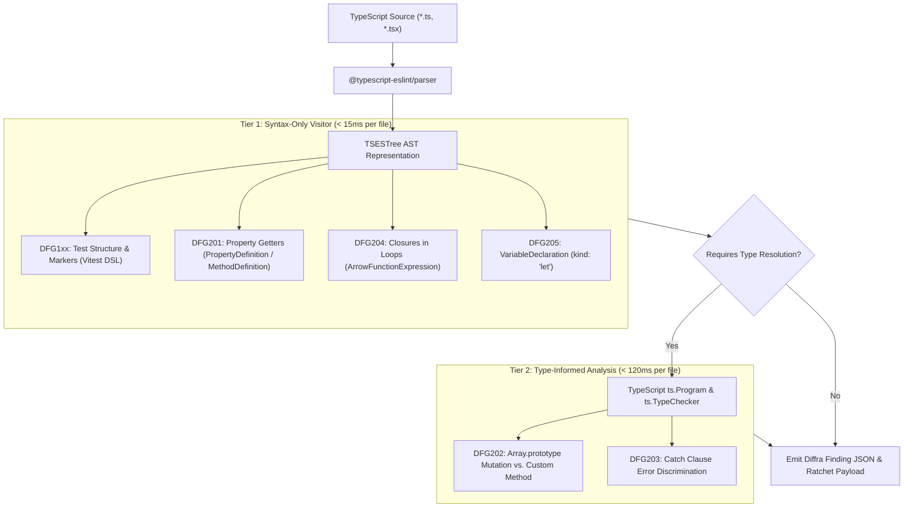

# TypeScript Static Analysis, Tooling Ecosystem, and Functional Architecture Plan

Status: Architecture Plan & Technical Specification, November 2026.  
Scope: TypeScript Language Adapter, ESLint, `eslint-plugin-functional`, `@typescript-eslint`, `ts-pattern`, Vitest, and rules DFG1xx / DFG2xx.

---

## 1. Executive Summary & Architectural Positioning

TypeScript occupies a distinctive position in software engineering: it is a statically typed superset of JavaScript
that brings compile-time type safety to an inherently dynamic, prototype-based runtime. While TypeScript supports
object-oriented patterns (classes, interfaces, access modifiers), modern idiomatic TypeScript strongly favors functional
architectures: discriminated unions, immutable data flows, higher-order functions, and expression-oriented patterns.

However, JavaScript engines (V8, JavaScriptCore, SpiderMonkey) and the TypeScript language itself permit pervasive
imperative and mutable escape hatches: `let` reassignments, array mutating methods (`push`, `splice`, `sort`), mutable
object properties, unhandled Promise rejections, and expensive computation inside object getter accessors. Furthermore,
in test suites (powered by Vitest or Jest), tests frequently suffer from assertions scattered across execution paths,
missing diagnostic messages, and implicit state sharing across `beforeEach` hooks.

This document defines the architectural specification for the **TypeScript Diffra Guardrails Adapter**. It establishes:

1. **The 6-Question Adapter Contract** for TypeScript test frameworks (Vitest and Jest).
2. **Upstream Static Analysis Lineage & Attribution** covering ESLint, `eslint-plugin-functional`, `@typescript-eslint`,
   and `ts-pattern`.
3. **AST Traversal Architecture** balancing sub-second syntax-only checking (ESTree) with deep type-informed checks
   (`ts.TypeChecker`).
4. **DFG1xx Test Constraints & DFG2xx Functional Architecture Rules** tailored to modern TypeScript and ECMAScript.
5. **Reconciliation of Functional Idioms with High-Performance JavaScript Engines** (V8 hidden classes, inline caches,
   and memory allocation overhead).

---

## 2. Upstream Tooling, Technical Lineage & Licensing

The TypeScript adapter integrates patterns from established AST linters and functional libraries in the JavaScript
ecosystem. All referenced upstream tools are permissively licensed under the MIT License.

| Project | Repository & Link | License | Architectural Inspiration & Role in Diffra Guardrails |
| --- | --- | --- | --- |
| **ESLint** | [eslint/eslint](https://github.com/eslint/eslint) | MIT | The standard static analysis platform for JavaScript/TypeScript. Provides AST visitor patterns, rule contexts, token traversal, and source comment mapping. |
| **eslint-plugin-functional** | [eslint-functional/eslint-plugin-functional](https://github.com/eslint-functional/eslint-plugin-functional) | MIT | Seminal functional linter for TypeScript. Directly inspired Diffra's immutable data heuristics (`prefer-readonly-type`, `no-let`, `no-mutating-methods`, `no-try-statements`). |
| **@typescript-eslint** | [typescript-eslint/typescript-eslint](https://github.com/typescript-eslint/typescript-eslint) | MIT | Provides the parser (`@typescript-eslint/parser`) and type-services bridge connecting ESLint AST nodes to the TypeScript compiler's `ts.TypeChecker`. |
| **ts-pattern** | [gvergnaud/ts-pattern](https://github.com/gvergnaud/ts-pattern) | MIT | Production pattern matching library for TypeScript. Serves as the designated expression-oriented target for replacing imperative `switch`/`if` blocks in DFG205. |
| **Vitest** | [vitest-dev/vitest](https://github.com/vitest-dev/vitest) | MIT | Vite-native next-generation test runner. Defines the AST structure (`test`, `it`, `describe`, `expect`) and failure message conventions for DFG1xx. |

### Upstream Attribution & License Compatibility

All components integrated into or referenced by the TypeScript adapter adhere strictly to the MIT License. Findings
emitted by Diffra Guardrails cite upstream rule equivalences where appropriate (e.g., mapping `functional/no-let` to
DFG205 and `functional/immutable-data` to DFG202).

---

## 3. The Six-Question Adapter Contract for TypeScript

The Diffra Guardrails adapter contract bridges Vitest and Jest into uniform semantic checks across test files.

| Question | Vitest Implementation | Jest Implementation |
| --- | --- | --- |
| **1. What is a test?** | Call expressions targeting `test(...)`, `it(...)`, and their chained variants (`it.each`, `it.concurrent`, `it.only`, `it.skip`). | Call expressions targeting `test(...)`, `it(...)`, and their parameterized variants (`it.each`). |
| **2. What is an assertion?** | Call expressions targeting `expect(...)` chains (e.g., `expect(a).toBe(b)`), `expect.soft(...)`, and Node.js `assert.*`. | Call expressions targeting `expect(...)` chains and custom Jest matchers (`expect(a).toEqual(b)`). |
| **3. Where is the failure message?** | The **second argument** of `expect(actual, "custom failure message")`. | Custom message argument in libraries like `jest-expect-message` or custom matchers. |
| **4. How are comments reached?** | `sourceCode.getCommentsBefore(node)` and `sourceCode.getAllComments()` via ESLint `SourceCode` token API. | Same as Vitest: ESLint/Babel AST comment trivia associated with expression statements. |
| **5. How is size declared?** | File naming conventions (`*.unit.test.ts`, `*.integration.test.ts`), Vitest workspace projects, or JSDoc tags (`/** @tag small */`). | File naming conventions (`*.e2e.test.ts`) or `testEnvironment` docblocks (`/** @jest-environment node */`). |
| **6. How is shared context expressed?** | Enclosing `describe` blocks utilizing `beforeEach`, `beforeAll`, or test context fixtures (`it("...", ({ ctx }) => ...)`). | `beforeEach` and `beforeAll` invocations inside the lexical scope of `describe`. |

---

## 4. AST Traversal Architecture: Syntax-Only vs. Type-Informed Linting

To achieve sub-second execution speeds on pre-commit hooks while retaining semantic accuracy in CI, the TypeScript
adapter employs a two-tier evaluation strategy.



### 4.1 Tier 1: Syntax-Only Visitor (Pre-Commit & Agent Hook)

Over 80% of rules operate purely on syntax structures without requiring full TypeScript project type compilation:

- **DFG1xx Suite:** Validates `it()`, `describe()`, and `expect()` AST nodes and extracts `// Arrange`, `// Act`,
  `// Assert` comments in sub-millisecond time.
- **DFG205 (No `let`):** Direct inspection of `VariableDeclaration[kind='let']`.
- **DFG201 (Getters):** Detection of loops (`ForStatement`, `WhileStatement`) or collection creation inside
  `MethodDefinition[kind='get']`.

### 4.2 Tier 2: Type-Informed Analysis (CI & Deep Build)

When ambiguous syntax must be verified against actual type declarations:

- Identifies whether `.push()` or `.sort()` belongs to `Array<T>` or a specialized domain builder.
- Validates whether an exception caught in `catch (err)` is narrowed via `instanceof` or an assertion guard.
- Uses `@typescript-eslint/utils` to query `parserServices.program.getTypeChecker()`.

---

## 5. DFG1xx Test Constraints for Vitest & Jest

### 5.1 DFG101: Single Concept per Test

- **AST Target:** `CallExpression[callee.name=/^(it|test)$/]` first argument (`Literal`).
- **Detection Criteria:** Test titles must describe a single atomic behavior. Titles containing `" and "`, `", and "`,
  or multiple assertion verbs (`"creates user and sends email"`) are flagged.

### 5.2 DFG102: Explicit Arrange-Act-Assert Markers

- **AST Target:** Top-level statements within the test callback function.
- **Extraction:** Trailing/leading comments retrieved via `sourceCode.getCommentsBefore(statement)`.
- **Contract:**

  ```typescript
  it("calculates volume with standard dimensions", () => {
    // Arrange
    const dimensions = { length: 10, width: 5, height: 2 };

    // Act
    const volume = calculateVolume(dimensions);

    // Assert
    expect(volume, "Volume must equal length * width * height").toBe(100);
  });
  ```

- **Typo Guard:** Standalone single-word comments of 4+ characters resembling markers (`// Arange`, `// Aseert`) trigger
  DFG102 findings.

### 5.3 DFG103 & DFG104: Act Block Size and Contiguity

- **Target:** Statements positioned between `// Act` and `// Assert`.
- **Constraint:** The Act section must contain exactly one expression statement or variable initialization. Multi-step
  orchestrations must be moved to test setup fixtures.

### 5.4 DFG105: Single Assertion & Helper Verification

- **AST Target:** Call expressions targeting `expect(...)`.
- **Constraint:** Exactly one `expect()` invocation allowed per test. If multiple properties of an object must be
  validated, use compound assertion helpers or deep object matching (`toEqual` / `toStrictEqual`).

### 5.5 DFG106 & DFG107: Failure Message Slots & Quality

- **AST Target:** Second argument of `expect(actual, message)` in Vitest.
- **Evaluation:**
  - Empty or omitted message string: DFG106 finding.
  - Vague message string (`"should work"`, `"check value"`): DFG107 quality score penalty.
  - APIs lacking a failure message parameter emit a non-gated DFG106 warning.

---

## 6. DFG2xx Functional Architecture Rules for TypeScript

### 6.1 DFG201: No Behavior in Property Getters

- **AST Target:** `MethodDefinition[kind='get']` in classes and `Property[kind='get']` in object literals.
- **Detection Criteria:** Prohibits:
  - Iteration loops: `ForStatement`, `ForOfStatement`, `ForInStatement`, `WhileStatement`.
  - Array allocations: `ArrayExpression` (`[...]`) or `Array.from()`.
  - Asynchronous constructs: `AwaitExpression`, returning `Promise`.
  - Network/IO invocations: `fetch()`, DOM queries (`document.querySelector`).
- **Message Contract:** `"Property getters must be lightweight O(1) accessors without computational side-effects."`
- **Fix Contract:** `"Convert the getter accessor into an explicit member method."`

### 6.2 DFG202: Immutable Collections & Pure Transformations

- **AST Target:**
  - Invocations of mutating `Array.prototype` methods: `push()`, `pop()`, `shift()`, `unshift()`, `splice()`,
    `sort()`, `reverse()`.
  - Object property reassignments (`AssignmentExpression` on member expressions).
  - Mutable type annotations where `Readonly<T>` or `ReadonlyArray<T>` should be declared.
- **Modern ECMAScript 2023 Replacements:**
  - Replace `.push()` with array spread: `[...items, newItem]`.
  - Replace `.sort()` with `.toSorted()`.
  - Replace `.reverse()` with `.toReversed()`.
  - Replace `.splice()` with `.toSpliced()`.

  ```typescript
  // Anti-Pattern: In-place mutation (Flagged by DFG202)
  const items = [3, 1, 2];
  items.sort();

  // Guardrailed: Pure immutable transformation (ES2023)
  const items: readonly number[] = [3, 1, 2];
  const sorted = items.toSorted();
  ```

### 6.3 DFG203: Defensive Exception Discipline

- **AST Target:** `CatchClause` nodes.
- **Detection Criteria:**
  - Prohibits empty catch blocks (`catch (e) {}`).
  - Prohibits caught exceptions that are neither logged nor rethrown (`throw e`).
  - Prohibits generic catches without type narrowing. In TypeScript, caught errors are of type `unknown` (or `any`).
    Handlers must explicitly narrow the error with type guards (`if (err instanceof DomainError)`) or use Result types
    (`neverthrow`).
- **Message Contract:** `"Caught exception must be narrowed with a type guard and either rethrown or handled explicitly."`

### 6.4 DFG204: Zero-Allocation Closures & Function Hoisting

- **AST Target:** `ArrowFunctionExpression` or `FunctionExpression` defined inside loop bodies (`ForOfStatement`,
  `WhileStatement`) or high-frequency render functions.
- **Detection Criteria:**
  - Flag inline lambdas that do not capture enclosing lexical scope variables and can be hoisted to module scope.
  - In V8, recreating closure contexts within tight iterations incurs non-trivial allocation overhead and triggers
    scavenger GC cycles.
- **Fix Contract:** `"Hoist pure closure to module scope or use a static top-level helper function."`

### 6.5 DFG205: Single Assignment & Expression Flow

- **AST Target:**
  - `VariableDeclaration[kind='let']`.
  - Reassignment via `AssignmentExpression`.
- **Detection Criteria:**
  - Prohibits declaring a variable with `let` and conditionally reassigning it inside `if`/`else` or `switch` blocks.
  - Mandates single assignment using `const` paired with ternary expressions or `ts-pattern` `match()` expressions.

  ```typescript
  // Procedural Anti-Pattern (Flagged by DFG205)
  let status: string;
  if (score > 90) {
    status = "Distinction";
  } else if (score > 50) {
    status = "Pass";
  } else {
    status = "Fail";
  }

  // Guardrailed: Functional Pattern Matching (ts-pattern)
  import { match } from "ts-pattern";

  const status = match(score)
    .when((s) => s > 90, () => "Distinction")
    .when((s) => s > 50, () => "Pass")
    .otherwise(() => "Fail");
  ```

---

## 7. Reconciling Functional Idioms with High-Performance JavaScript Engines

Functional programming in TypeScript introduces architectural trade-offs at the JavaScript runtime level:

1. **Garbage Collection Pressure:** Repeated array cloning (`[...items, x]`) and intermediate object spreads create
   ephemeral young-generation objects that fill V8 nursery spaces.
2. **Hidden Class Transitions:** Dynamic object property assignments break V8 hidden classes (Shapes), degrading
   monomorphic call sites to megamorphic stubs.

Diffra Guardrails resolves this tension through the **Encapsulated Scope Boundary**:

### 7.1 Encapsulated Procedural Buffers

In performance-critical domains (parsers, byte streams, WebGL render loops, data virtualization):

- In-place mutation is strictly permitted inside a local, private function scope provided the mutated structure never
  crosses module or class boundaries.
- The use of typed arrays (`Uint8Array`, `Float32Array`) and pre-allocated buffers is exempted from DFG202 upon
  annotation:

```typescript
// PERMITTED: Encapsulated buffer manipulation for performance
export function computeHistogram(data: readonly number[]): Readonly<Uint32Array> {
  const bins = new Uint32Array(256); // Local scratchpad buffer
  for (let i = 0; i < data.length; i++) {
    const val = data[i];
    if (val >= 0 && val < 256) {
      bins[val]++; // Permitted local mutation
    }
  }
  return bins; // Returned as readonly view
}
```

---

## 8. Architectural Style Bundles for TypeScript

The TypeScript adapter provides three pre-configured bundle profiles:

| Profile | Target Audience | DFG201 | DFG202 | DFG203 | DFG204 | DFG205 |
| --- | --- | --- | --- | --- | --- | --- |
| `strict-functional` | Domain cores, financial ledgers, compiler AST transformations | Error (Gated) | Error (No mutating methods; `ReadonlyArray` mandatory) | Error (Result monad or typed guard mandatory) | Error (No inline closures in loops/renders) | Error (`no-let` strictly enforced; `ts-pattern` required) |
| `pragmatic` | Standard Node.js backend services, Fullstack Next.js/Remix apps | Error (Gated) | Error (Domain immutability; ES2023 copy methods) | Error (No empty catch blocks; rethrow required) | Warning (Flag closures in hot loops) | Error (Prefer `const`; ternary expressions) |
| `high-performance` | Canvas engines, real-time data streaming, game engines | Error (Gated) | Warning (Typed arrays & local buffers exempted) | Error (Exceptions banned from render loop) | Error (Zero allocation in tick functions) | Warning (Local index `let` allowed in tight loops) |

---

## 9. Durable Literature, TC39 Proposals & Technical Bibliography

1. **TC39 Proposals & ECMAScript Specifications:**
   - *Change Array by Copy (ECMAScript 2023):* <https://github.com/tc39/proposal-change-array-by-copy>  
     *Authoritative Specification:* Introduces `.toSorted()`, `.toReversed()`, `.toSpliced()`, and `.with()` to
     eliminate imperative array mutation.
   - *TC39 Pattern Matching Proposal (Stage 1/2):* <https://github.com/tc39/proposal-pattern-matching>  
     *Authoritative Specification:* The formal evolution toward native expression-oriented pattern matching in JavaScript.
   - *TC39 Record & Tuple Proposal (Stage 2):* <https://github.com/tc39/proposal-record-tuple>  
     *Authoritative Specification:* Deeply immutable value primitives for JavaScript.
2. **V8 Engine Performance Architecture (Mathias Bynens & Benedikt Meurer):**
   - *JavaScript Engine Fundamentals: Shapes and Inline Caches:* <https://mathiasbynens.be/notes/shapes-ics>  
     *Technical Rationale:* Explains why consistent object shapes and predictable property initialization orders
     dominate V8 JIT performance.
   - *High-Performance JavaScript and Memory Management:* <https://v8.dev/blog>  
     *Empirical Rationale:* Details young-generation garbage collection costs and closure allocations.
3. **Alexis King — Parse, Don't Validate:**
   *Durable Link:* <https://lexi-lambda.github.io/blog/2019/11/05/parse-dont-validate/>  
   *Authoritative Rationale:* Grounding for TypeScript discriminated unions and type narrowing: capture invariants in the
   type system at the boundary rather than checking ad-hoc booleans downstream.
4. **Eric Elliott — Composing Software: Why Pure Functions Matter in JavaScript:**
   *Durable Link:* <https://medium.com/javascript-scene/master-the-javascript-interview-what-is-a-pure-function-d1c076bec976>  
   *Authoritative Analysis:* Demonstrates how immutability and referential transparency eliminate concurrency and
   state-synchronization bugs in asynchronous JavaScript applications.
5. **Empirical Test Smells in JavaScript/TypeScript (Peruma et al., 2021):**
   *Durable Link:* <https://doi.org/10.1145/3463274.3463335>  
   *Empirical Research:* Investigates the prevalence and maintainability decay caused by assertion roulette, redundant
   assertions, and missing failure diagnostics in modern JavaScript test frameworks.
